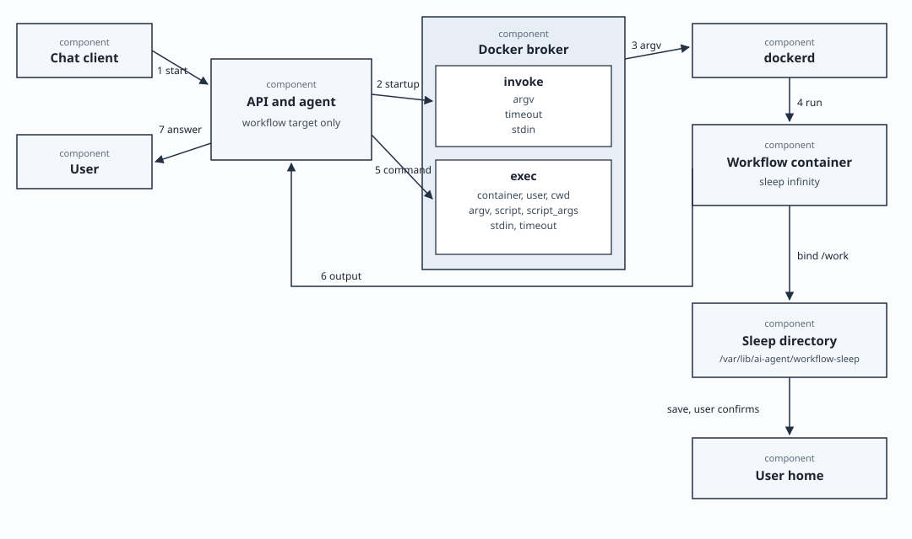

# Contributing

Setup is the [README quick start](README.md#quick-start). Run the tests with `pytest` from the repo root, using the project virtualenv.

## Comments

Write a short comment when the intent is not obvious from the name. One or two lines is enough. Say what the step is for, in plain language.

```python
# Check if the model's command is allowed, and whether it is safe enough
# to auto-approve without the user
```

Skip the trailing period when the comment is one sentence. Use periods only when it is more than one sentence.

Put these notes on the higher-level flow, especially the agent loop in `ai_agent/agent/agent.py`. That method is the only place that orders parse, policy, permission, and execution. Add a comment in a helper only when a branch is easy to misread, such as a workflow container skipping host policy.

## Avoiding security regressions

Read this before adding commands, tools, or policy rules.

### 1. Never add shell execution

```python
# FORBIDDEN
subprocess.run(command_string, shell=True)
subprocess.run(["/bin/sh", "-c", model_output])
```

```python
# CORRECT
subprocess.run(argv_list, shell=False)
```

### 2. Never trust model output

All tool arguments are **attacker-controlled input**. Validate structure (Pydantic) **and** semantics (policy engine).

### 3. Do not parse shell syntax from strings

If you need new chaining behavior, add a new **`CommandExpr` type** and validate it explicitly — do not regex-match user/model strings.

### 4. Expand allow-lists carefully

When adding policy rules, specify:

- binary name
- subcommand (if applicable)
- path argument requirements
- network restrictions (if applicable)
- risk level

Default for unmatched commands is **FORBIDDEN**.

### 5. Beware implicit privilege escalation

| Change | Risk |
|--------|------|
| Adding `ai` to `docker` group | Near-root access |
| Allowing `docker run` | Container escape / mount host FS |
| Allowing remote `curl` | Data exfiltration |
| Allowing `\| sh` or `xargs` | Full shell bypass |
| Broadening readable paths to `/` | Credential exposure |

### 6. Chain risk aggregation

When adding operators, compute effective risk as **max(segment risks)** and reject the whole expression if any segment is FORBIDDEN.

### 7. Do not let the model self-approve

Never encode approval as a tool result the model can write. Approval must come from the CLI input layer.

### 8. Test policy, not just happy paths

Add tests for:

- forbidden patterns
- path traversal
- network exfil attempts
- chained bypass attempts
- confirmation gates
- audit records on denial

Run tests:

```bash
pytest
```

## Workflows

A workflow chat does not run commands on the host. The client names a workflow. The server owns the container name, the sleep directory, and every Docker call. Sending stays closed until the container is ready.



Startup goes through `invoke`. The broker checks whether the image tag is already present, builds it with BuildKit when it is not, and starts the container with `docker run` as `sleep infinity`. A later open of the same chat uses `docker start` on that container. The model never supplies this argv. The only writable mount is `/work`, bind-mounted from `/var/lib/ai-agent/workflow-sleep/<user>/<conversation>`.

The API process is not in the `docker` group and does not open the Docker socket. It talks to `ai-agent-docker` on `/run/ai-agent/docker.sock`. That process is the broker, and it has two calls. `invoke(argv, timeout, stdin)` is for lifecycle: image inspect, a fixed BuildKit build, `docker run`, `docker start`, `docker inspect`, and `docker rm`. `exec(container, user, cwd, argv, script, script_args, stdin, timeout)` is how a command enters a container that already exists. The broker authorizes the argv before anything is executed, and it refuses a shell string, a Docker path, a host network, or a mount that is not the sleep volume or a read-only Nix store.

Once the container is up, the model has one target, `workflow`. `run_command`, `run_commands`, and `run_tool` skip host policy and skip the user prompt. That is deliberate. Inside the container the model may run the tools the manifest gave it, and other commands, including as root in the container. `run_tool` entrypoints come from the workflow lock, not from a path the model invents. Output comes back as the tool result. The model then calls `respond`, and that text is the answer the user sees.

A normal chat is the opposite boundary. Commands run on the host as the approved Linux user. `default_policy.yaml` decides what is allowed, confirmation mode decides who must say yes, and network tools stay on localhost. A workflow trades that for a sandbox with wide permission inside it. The container has its own bridge network, so a workflow tool may reach the internet. It does not share the host network. Root in the container is an unprivileged uid on the host, because dockerd runs with user-namespace remap.

The sandbox is still closed on the host side. The container cannot mount the Docker socket, `/`, `/home`, or the agent tree. Command working directories and `write_file` stay under `/work`. The container is started with `no-new-privileges`, without `SYS_ADMIN`, and with a process limit. Stopping the workflow removes the container and leaves the sleep directory. That directory is the saved sleep state. The next start bind-mounts the same path, so files in `/work` survive.

Saving into the user's own environment is a different step, and it is required for anything that should leave the sandbox. The model cannot do it by running a command, because `/work` is not the user's home. The turn loop does not perform this copy. Promotion copies chosen files from `/work` into that home only after the user says yes or picks items. Confirmation mode and session grants do not cover it. The model does not supply the file list or the approval. The write runs as the approved Linux user, stays under that user's home, and a root executor is refused.
